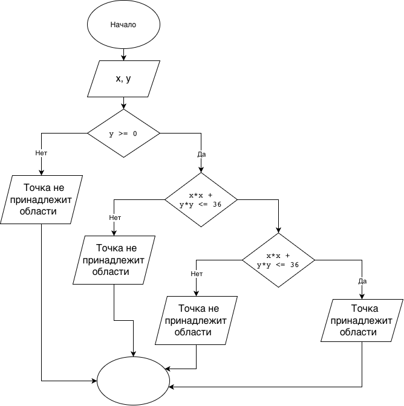

# Домашнее задание к работе 6

## Условие задачи
Составить программу, которая проверяет, принадлежит ли заданная пользователем точка с координатами (x, y) заштрихованной области (верхний полукруг радиуса 6 с вырезанной правой четвертью круга радиуса 3 в центре), и выводит на экран соответствующее сообщение.

## 1. Алгоритм и блок-схема

### Алгоритм
1. **Начало**
2. Ввод с клавиатуры координат точки: `x` и `y`.
3. Проверка условий принадлежности области:
   - Лежит ли точка в верхней полуплоскости (`y >= 0`).
   - Находится ли точка внутри большого полукруга радиуса 6 (`x * x + y * y <= 36`).
   - Находится ли точка вне правого внутреннего выреза радиуса 3 (`x <= 0` или `x * x + y * y >= 9`).
4. Если все условия выполняются, вывести `"Точка принадлежит области"`.
5. Иначе вывести `"Точка не принадлежит области"`.
6. **Конец**

### Блок-схема
 

## 2. Реализация программы

```c
#include <stdio.h>

int main() {
    double x, y;

    printf("Введите координаты точки (x y): ");
    scanf("%lf %lf", &x, &y);

    if ((y >= 0) && (x * x + y * y <= 36.0) && (x <= 0 || x * x + y * y >= 9.0)) {
        printf("Точка принадлежит области\n");
    } else {
        printf("Точка не принадлежит области\n");
    }

    return 0;
}
```

## 3. Результаты работы программы

```text
Введите координаты точки (x y): -2 3
Точка принадлежит области

Введите координаты точки (x y): 1 1
Точка не принадлежит области
```

## 4. Информация о разработчике

Цимбалист Костя бИЦТ-261
